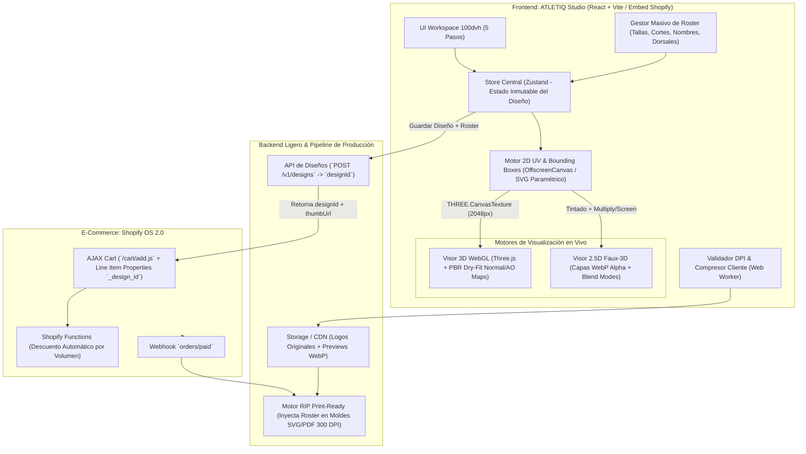

# Arquitectura Objetivo v3.0 — ATLETIQ Custom Engine

Este documento define **cómo debe quedar exactamente nuestra plataforma e-commerce y su motor de personalización en tiempo real**, sintetizando las mejores prácticas de ingeniería de los 5 referentes mundiales del sector (**Owayo**, **CustomInk**, **Kit Builder**, **Zakeke** y **Nike By You**) y corrigiendo las limitaciones del prototipo inicial v1.

---

## 1. Diagnóstico Crítico: Qué Corregimos del Prototipo v1

| Área | Limitación en Prototipo v1 | Solución en Arquitectura v3.0 (Objetivo) | Referente Base |
| :--- | :--- | :--- | :--- |
| **Realismo de Maquetas** | Vectores 2D dibujados a mano con degradados simples; aspecto ilustrativo. | **Motor Gráfico Dual**: Visor **3D WebGL (`.glb` + UV dinámico)** para prendas principales + Visor **2.5D Multicapa WebP** con pases fotográficos de pliegues, costuras *flatlock* y micro-malla *Dry-Fit*. | **Kit Builder + Nike By You** |
| **Edición en Prenda** | Escudo y texto en coordenadas fijas sin interacción directa en el lienzo. | **Lienzo Interactivo con Gizmos**: Arrastrar, rotar y escalar libremente sobre el molde, con imanes de centrado, recorte por **Bounding Boxes (OBB/AABB)** y semáforo de resolución **DPI en vivo**. | **CustomInk Design Lab** |
| **Gestión de Equipos (Roster)** | Lista básica acoplada al estado local del carrito. | ** Arquitectura `Single-Design-ID`**: Un único diseño maestro inmutable al que se vincula una matriz de $N$ jugadores (talla, corte hombre/mujer/niño, nombre, dorsal) **sin duplicar imágenes ni texturas**. | **Owayo** |
| **Interfaz UX / Layout** | Estudio incrustado a mitad de una landing page con scroll largo. | **Separación Tienda vs. Workspace App-Like (`100dvh`)**: Catálogo rápido estilo Nike + Configurador a pantalla completa sin distracciones con barra de progreso en 5 pasos. | **Owayo + Nike By You** |
| **Integración Shopify & Taller** | Propiedades planas simuladas en cliente. | **Puente Asíncrono Print-Ready**: `/cart/add.js` recibe sólo `_design_id` + `_preview_webp` ligero (~25 KB); un worker genera tras la compra los moldes vectoriales **SVG/PDF a 300 DPI con sangrado de costura**. | **Zakeke** |

---

## 2. Arquitectura General del Sistema



---

## 3. Estructura de Pantallas y Experiencia de Usuario (UX)

Nuestra web se dividirá en **dos experiencias claramente diferenciadas** para maximizar conversión y usabilidad móvil:

### A. Vitrina E-Commerce (Storefront)
1. **Header Minimalista Deportivo**: Navegación por disciplinas (*Fútbol, Ciclismo, Basket, Running, E-Sports, Accesorios*), buscador, acceso a *"Mis Diseños Guardados"* y Carrito.
2. **Hero de Conversión Directa**: Selector rápido de deporte + vista interactiva 2.5D ultrarrápida (estilo *Nike By You*) que carga en `< 100 ms`.
3. **Catálogo Filtrable por Plantillas Base**: En lugar de mostrar una sola camiseta vacía, el usuario ve **30+ diseños base profesionales** (*Clásico, Rayas, Degradado Pro, Geométrico, Retro*) que puede abrir con 1 clic en el configurador.
4. **Calculadora Transparente de Precios y Tiempos**: Tabla interactiva de descuentos por volumen y fecha exacta garantizada de entrega antes de entrar a diseñar.

### B. El Configurador Fullscreen ("Design Lab 3D/2.5D")
Al pulsar *"Personalizar"*, se abre una interfaz de aplicación dedicada (`height: 100dvh`, sin header ni footer de tienda que roben espacio):

* **Barra Superior del Estudio**:
  * Botón `← Volver al catálogo` | Selector rápido de Prenda | Pasos numerados: **`1. Diseño` → `2. Colores` → `3. Logos` → `4. Textos/Dorsales` → `5. Tallas y Equipo`** | Botón `Guardar Boceto / Compartir Link` | Precio unitario dinámico + CTA **`Siguiente: Tallas →`**.
* **Zona Central (70% Desktop / 55% Mobile)**:
  * Visor 3D/2.5D limpio con fondo neutro de estudio.
  * Controles flotantes minimalistas: Vistas rápidas (`Frente`, `Espalda`, `Izquierda`, `Derecha`, `Zoom Costura`), toggle `3D Interactivo / Vista Plana 2D`, y botón `Deshacer / Rehacer (Ctrl+Z)`.
  * Cuando el usuario selecciona un escudo o texto, aparece el **recuadro punteado del Área Imprimible Segura** y el manejador (*gizmo*) para mover, escalar, rotar o centrar magnéticamente.
* **Panel Lateral / Inferior en Móvil (30% Desktop / 45% Bottom-Sheet Mobile)**:
  * Controles contextuales exclusivos del paso activo (evita saturar la pantalla con 50 botones a la vez).
* **Paso 5 — Modal / Vista Completa de Roster de Equipo (Estilo Owayo)**:
  * Matriz tipo hoja de cálculo rápida (con importación desde Excel/CSV pegando celdas): `Corte (Hombre / Mujer / Niño)`, `Talla`, `Cantidad`, `Nombre Espalda`, `Número Dorsal`, `Pantalón Corto (Opcional)`.
  * Vista previa instantánea al hacer clic en cualquier fila (ej. clic en el jugador #7 "MATEO" muestra cómo se ve un nombre corto vs. clic en el #14 "FERNÁNDEZ-GARCÍA" para comprobar el auto-ajuste de ancho tipográfico).

---

## 4. Estructura Objetivo de Carpetas de Código (`src/`)

Cuando implementemos el motor definitivo tras analizar las capturas de **REA**, el código fuente evolucionará a esta arquitectura limpia y desacoplada:

```text
sport-custom-studio/
├── blueprint/                        # Documentación de ingeniería de los 5 referentes
├── schemas/                          # Contratos JSON de diseño, roster y producción
├── rea-captures/                     # Archivos .har y payloads capturados con REA
├── tools/                            # Scripts de inspección y extracción de esquemas
└── src/
    ├── engine/                       # MOTOR INDEPENDIENTE (Portátil a Shopify sin cambios)
    │   ├── core/
    │   │   ├── designStore.js        # Estado inmutable + Undo/Redo history + serializador JSON
    │   │   ├── boundingBoxMath.js    # Geometría OBB/AABB, imanes de centrado y colisión de costuras
    │   │   └── dpiValidator.js       # Cálculo de DPI físico (px / pulgadas) y compresión ImageBitmap
    │   ├── compositor/
    │   │   ├── svgPatternCompiler.js # Inyecta colores hex/Pantone en las zonas del patrón SVG
    │   │   ├── uvCanvasRenderer.js   # Compone SVG + Logos + Slots de Texto en OffscreenCanvas 2048px
    │   │   └── layerStack25D.js      # Motor estilo Nike: apila WebP alpha + multiply AO + screen luz
    │   ├── viewer3d/
    │   │   ├── GarmentCanvas3D.jsx   # Escena Three.js / WebGL con iluminación de estudio HDRI
    │   │   ├── FabricShaderPBR.js    # Material con CanvasTexture + Dry-Fit NormalMap + Seam AOMap
    │   │   └── DecalRaycaster.js     # Selección y arrastre directo sobre el modelo 3D vía coordenadas UV
    │   └── exporter/
    │       ├── printReadyBuilder.js  # Genera el manifiesto vectorial a escala real (300 DPI + sangrado)
    │       └── shopifyBridge.js      # Conector `/cart/add.js`, Line Item Properties y Webhooks
    ├── components/
    │   ├── storefront/               # Vitrina E-commerce (Hero, Catálogo de plantillas, Calidad)
    │   └── studio/                   # Interfaz 100dvh en 5 pasos + Hoja de cálculo de Roster
    └── assets-spec/                  # Plantillas base GLB, mapas Normal/AO Dry-Fit y máscaras WebP
```

---

## 5. Flujo de Trabajo con REA (Ingeniería Inversa de Interoperabilidad y Mecánicas)

Para pasar de este plano arquitectónico a la implementación exacta:
1. Ejecuta tus sesiones de captura con **REA** siguiendo la guía de [`rea-captures/README-CAPTURAS-REA.md`](../rea-captures/README-CAPTURAS-REA.md).
2. Guarda los archivos `.har` o respuestas `.json` en su subcarpeta correspondiente dentro de `rea-captures/`.
3. Ejecuta nuestro analizador local (`node tools/rea-har-analyzer.mjs`) para extraer limpiamente las estructuras JSON, resoluciones de mapas UV, matemáticas de recorte y payloads de carrito.
4. Ajustaremos los contratos de [`schemas/`](../schemas/) con los hallazgos reales y construiremos `src/engine/` combinando lo mejor de los cinco gigantes.
