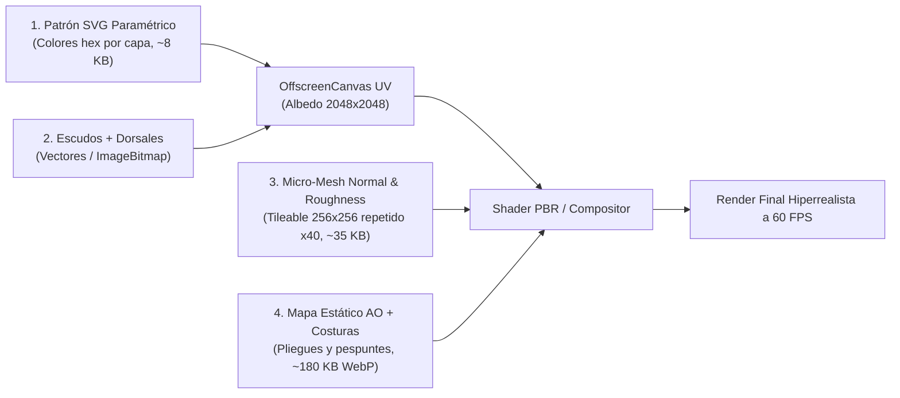

# 03. Análisis Técnico: Kit Builder (`kitbuilder.co.uk`)

**Rol en nuestra arquitectura:** Referente B2B en **superposición realista de patrones vectoriales (SVG) sobre micro-texturas físicas de tejido deportivo (*Dry-Fit / Micromesh / Piqué*)** sin saturar la GPU del navegador.

---

## 1. El Secreto del Realismo Textil Ligero

¿Por qué en nuestro prototipo v1 la camiseta se veía "plana" y en Kit Builder parece tela deportiva real con poros transpirables, brillos en los hombros y relieve en las costuras, pesando menos de `1.5 MB` en total?

Porque **separan completamente la matemática del color (Vector SVG infinito) de la física de la tela (Mapas estáticos repetibles PBR)**.

---

## 2. Arquitectura de 4 Capas de Textura (El Pipeline de Composición)



### Capa 1: El Patrón de Color Vectorial (SVG Limpio)
Cada diseño de camiseta (rayas, degradado geométrico, franja diagonal, chevrons) es un archivo SVG ligero cuyas rutas (`<path>`) tienen clases o atributos semánticos (`data-color-slot="1"`, `data-color-slot="2"`, `data-color-slot="3"`):
* Cambiar de azul a rojo **no pide nada al servidor**: sólo muta el `fill` de los nodos SVG en memoria y repinta el `OffscreenCanvas` UV.

### Capa 2: Micro-Textura Repetible del Tejido (`Tileable Weave Map`)
En vez de cargar una foto gigante de `4096×4096` de tela (que pesaría `8 MB`), se carga un único mosaico sin costuras (*seamless tile*) de `256×256 px` (~35 KB) que representa los microporos hexagonales del poliéster **CoolDry / Dry-Fit**.
* En WebGL (`Three.js`):
  ```js
  dryFitNormalMap.wrapS = THREE.RepeatWrapping;
  dryFitNormalMap.wrapT = THREE.RepeatWrapping;
  dryFitNormalMap.repeat.set(38, 38);
  material.normalScale.set(0.28, 0.28);
  ```
* En 2D Canvas: se crea un `ctx.createPattern(dryFitTile, 'repeat')` superpuesto con `globalCompositeOperation = 'multiply'` al `18%` de intensidad.

### Capa 3: Mapa de Oclusión Ambiental y Costuras (`AO + Stitching Map`)
Es una imagen en escala de grises de `1024×1024` o `2048×2048` en WebP donde:
* El blanco puro (`#FFFFFF`, valor `1.0`) son las zonas lisas expuestas a la luz.
* Los grises oscuros (`0.35 - 0.85`) son las caídas naturales de las arrugas del pecho, axilas y cuello, más el punteado milimétrico de la costura *overlock* deportiva.
* Al multiplicarse matemáticamente contra el color del usuario ($C_{\text{out}} = C_{\text{SVG}} \times C_{\text{AO}}$), **incluso si el usuario elige negro carbón o amarillo flúor, los pliegues y costuras se mantienen nítidos y creíbles**.

### Capa 4: Iluminación Especular Anisotrópica (`Roughness / Sheen`)
El poliéster deportivo tiene un ligero brillo sedoso en las crestas de los pliegues que el algodón mate no tiene. Con `roughness: 0.58` y `sheen: 0.25` en `MeshPhysicalMaterial` (o una capa `screen` al `12%` en 2.5D), la prenda cobra volumen tridimensional inmediato.

---

## 3. Qué Inspeccionar con REA en Kit Builder

1. **Pestaña Network (Filtros `svg`, `webp`, `png`, `glb`/`obj`/`json`) al abrir una demo de Fútbol**:
   * Ver exactamente cuántas texturas estáticas descargan por prenda (normal map, ambient occlusion, stitches) y qué resolución tienen.
2. **Estructura interna de sus SVGs de diseño**:
   * Inspeccionar cómo organizan los `<g>` y `<path>` de un diseño tricolor dentro del espacio UV para que las líneas de los hombros coincidan exactamente con las mangas en el modelo 3D.
